 

 

### 🏆 Wins

### 📜 Certifications & Programs

### 🛠️ Arsenal

 
 

### 🚀 Featured Builds

<table>
<tr>
<td width="50%" valign="top">

**[🤖 kiro-sdlc-agent-harness](https://github.com/n0zzzy/kiro-sdlc-agent-harness)** 👑 
An orchestrator drives <b>7 specialist AI agents</b> through the full SDLC, from a plain-English request to a <b>live, deployed AWS app</b>, with human approval gates 
  

</td>
<td width="50%" valign="top">

**[🧠 novamart-multi-agent-agentcore](https://github.com/n0zzzy/novamart-multi-agent-agentcore)** 
<b>5-agent</b> customer support with <b>parallel multi-agent RAG</b>, guardrails, shared state & CloudWatch/X-Ray observability on Bedrock AgentCore 
 

</td>
</tr>
<tr>
<td width="50%" valign="top">

**[☸️ production-ready-ai-agents-eks](https://github.com/n0zzzy/production-ready-ai-agents-eks)** 
Enterprise AI agent platform on <b>EKS + Bedrock</b>: self-managed vs managed tracks, model-agnostic <b>LiteLLM</b> plane 
 

</td>
<td width="50%" valign="top">

**[🛰️ cloudops-sentry](https://github.com/n0zzzy/cloudops-sentry)** 
<b>Autonomous DevOps & SRE agent</b> that prevents incidents before they happen. Built for the DevKada x Clanker Cloud challenge 
 

</td>
</tr>
<tr>
<td width="50%" valign="top">

**[💬 ai-customer-support-agent](https://github.com/n0zzzy/ai-customer-support-agent)** 
Support agent with <b>order tracking & refunds via Gateway/Lambda</b>, RAG, Code Interpreter, web browsing & long-term memory 
 

</td>
<td width="50%" valign="top">

**[🐾 pawfeed-smart-pet-feeder](https://github.com/n0zzzy/pawfeed-smart-pet-feeder)** 
Smart pet feeder <b>web + PWA</b> with Playwright tests, Allure reports & CI/CD. <a href="https://pawfeed-smart-pet-feeder.vercel.app"><b>Live demo →</b></a> 
 

</td>
</tr>
</table>

<b>More builds:</b> <a href="https://github.com/n0zzzy/aws-eks-workshop">☸️ EKS + Karpenter lab</a> · <a href="https://github.com/n0zzzy/azure-ai-foundry-multitool-agent">🔷 Azure AI Foundry agent</a> · <a href="https://github.com/n0zzzy/aws-bedrock-customer-support-flow">🔁 Bedrock Flows router</a> · <a href="https://github.com/n0zzzy/kiro-ph-data-dashboard">🌊 PH flood control dashboard</a> · <a href="https://github.com/n0zzzy/aws-multi-agent-orchestration">🎛️ Step Functions orchestration</a> · <a href="https://github.com/n0zzzy/aws-multi-agent-choreography">🔀 EventBridge choreography</a>

### 📊 Stats

  

 

🐺 <i>"I have no enemies."</i> — widgets self-generated every 6 hours via GitHub Actions

