


 

 




<a href="https://www.linkedin.com/feed/update/urn:li:activity:7496833769048276992/"></a>
<a href="https://www.linkedin.com/feed/update/urn:li:activity:7502561620263481344/"></a>
<a href="https://www.linkedin.com/feed/update/urn:li:activity:7518483801849651200/"></a>


<a href="https://www.linkedin.com/feed/update/urn:li:activity:7510666348230799360/"></a>
<a href="https://www.linkedin.com/feed/update/urn:li:activity:7510175401642586112/"></a>
<a href="https://www.linkedin.com/feed/update/urn:li:activity:7517789317419765761/"></a>
<a href="https://www.linkedin.com/feed/update/urn:li:activity:7510118883748495360/"></a>








<b>📖 Agentic engineering glossary</b> (click to expand)

 

| Term | What it means |
|---|---|
| **Harness engineering** | Everything built *around* the model so an agent is reliable in production: tools, memory, guardrails, evals, observability, permissions, and human checkpoints. |
| **Guardrails** | Input/output filters that block unsafe content, PII leaks, and prompt-injection attempts (e.g. Amazon Bedrock Guardrails). |
| **Human-in-the-loop (HITL)** | The agent pauses and waits for a person to approve or reject a risky step, e.g. a deploy or a high-value booking. |
| **Evaluation / LLM-as-a-Judge** | Automatically scoring agent answers (correctness, goal success, tool choice), often with a stronger model acting as the grader. |
| **Observability** | Traces, logs, and metrics for every agent step (OpenTelemetry, Langfuse, CloudWatch, X-Ray) so failures can be debugged. |
| **MCP (Model Context Protocol)** | An open standard for plugging tools and data sources into agents. |
| **A2A (Agent-to-Agent)** | A protocol for agents to discover and call each other across services. |
| **RAG** | Retrieval-Augmented Generation: the agent searches a knowledge base first, then answers grounded in what it found. |
| **Orchestration vs. choreography** | Orchestration: one controller tells each agent what to do. Choreography: agents react to events on a shared bus with no central boss. |
| **Router / classifier** | A first step that labels a request and sends it to the right specialist or flow. |
| **Agentic coding** | Using coding agents (Claude Code, Codex, Kiro) to plan, write, test, and ship software under human review. |


<a href="https://github.com/n0zzzy/kiro-sdlc-agent-harness"></a>
<a href="https://github.com/n0zzzy/novamart-multi-agent-agentcore"></a>
<a href="https://github.com/n0zzzy/production-ready-ai-agents-eks"></a>
<a href="https://github.com/n0zzzy/cloudops-sentry"></a>
<a href="https://github.com/n0zzzy/ai-customer-support-agent"></a>
<a href="https://github.com/n0zzzy/pawfeed-smart-pet-feeder"></a>

<a href="https://github.com/n0zzzy/aws-eks-workshop"></a>
<a href="https://github.com/n0zzzy/azure-ai-foundry-multitool-agent"></a>
<a href="https://github.com/n0zzzy/aws-bedrock-customer-support-flow"></a>
<a href="https://github.com/n0zzzy/kiro-ph-data-dashboard"></a>
<a href="https://github.com/n0zzzy/aws-multi-agent-orchestration"></a>
<a href="https://github.com/n0zzzy/aws-multi-agent-choreography"></a>






  

 

<a href="https://www.linkedin.com/in/russelcarlo"></a>

